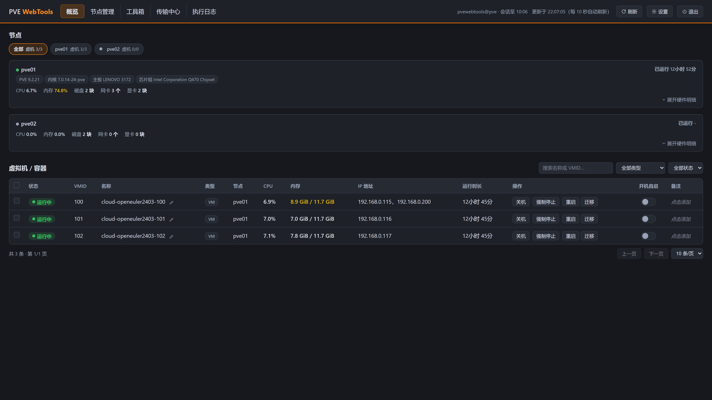
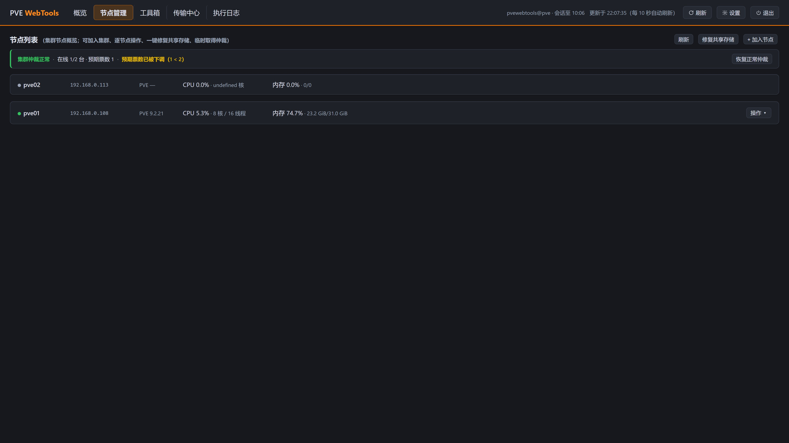
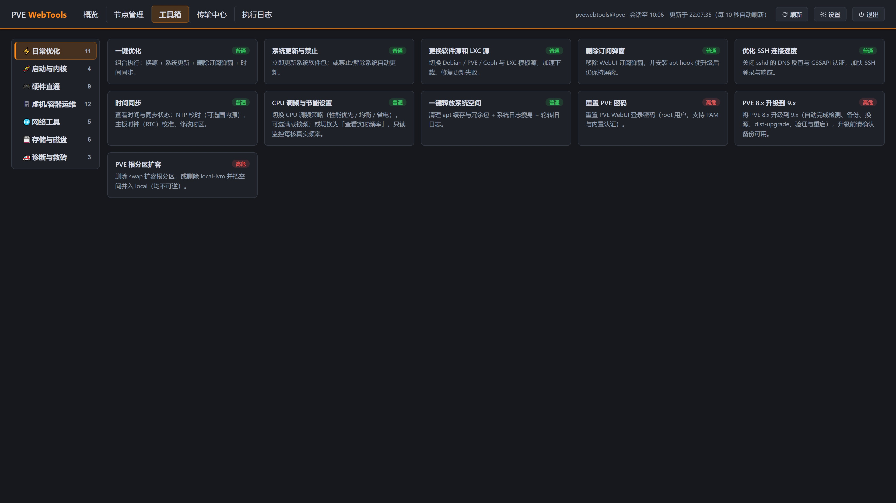
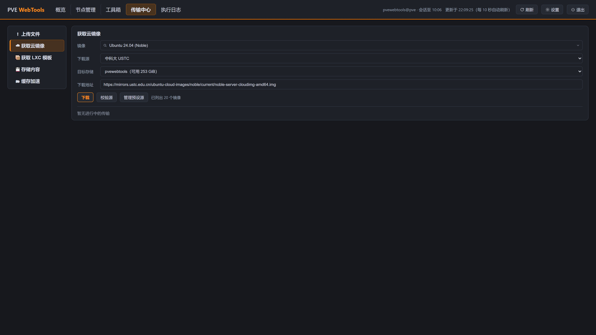
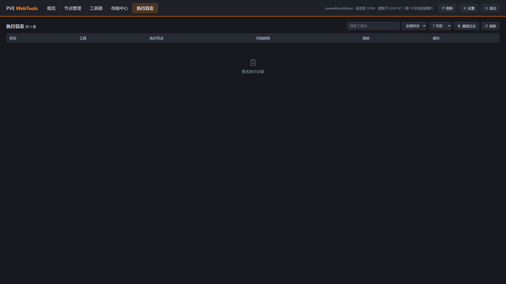

# PVE WebTools（开源版）

基于 Python **标准库**开发的 Proxmox VE 图形化 Web 管理工具，零第三方运行时依赖，
直接使用 PVE 自带的系统 Python（Debian 12 bookworm / Debian 13 trixie）即可运行。

> 以 GPL-3.0 开源发布，包含 7 大分类 **50 个**运维工具。

## 支持范围

- **PVE 版本**：8.x 与 9.x（Debian 12 / Debian 13）
- **CPU 架构**：x86_64（Intel / AMD）与 ARM64（aarch64，PVE 9 支持的 ARM 架构）
- CPU 调频、锁频、HWP/EPP、intel_pstate 等平台专属功能按架构与驱动自动适配降级

## 界面与功能

顶部五个页签：**概览 / 节点管理 / 工具箱 / 传输中心 / 执行日志**；
右上角「设置」弹窗内含**帮助手册**与当前版本号。

### 界面预览

**概览** —— 节点卡片（CPU / 内存 / 硬盘 / 网卡 / 显卡，硬件明细可展开）与虚拟机 / 容器统一列表；
支持搜索筛选、分页、批量启停、开机自启开关、备注编辑，每 10 秒自动刷新。



**节点管理** —— 集群节点列表；「+ 加入节点」拉新机入集群，「操作」下拉含重启节点 / 重启 PVE 服务 /
一键诊断 / 关机，工具栏可一键修复全集群共享存储，失去仲裁时可临时下调票数。



**工具箱** —— 7 大分类 50 个工具，按分类浏览、可搜索；高危操作需输入工具名作确认词。



**传输中心** —— 上传虚机模板 / 云镜像 / 磁盘镜像 / vBIOS，从国内镜像站下载云镜像与 LXC 模板，
浏览并批量清理共享存储内容。



**执行日志** —— 工具箱任务历史、执行步骤时间线与完整日志回看，可按状态筛选、按时间批量清理。



### 概览

- **节点卡片**：各节点 CPU / 内存实时使用率、在线状态、运行时长；两行布局展示 CPU / 内存 / 硬盘 / 网卡 / 显卡
  - 硬件明细：CPU 型号/插槽/频率/温度、内存条（插槽·容量·品牌·频率）、物理盘（容量/介质/温度/直通占用标记）、网卡（链路/速率/被直通占用标记）、显卡（型号/宿主使用或直通占用标记）
  - **后台异步预热**：概览慢采集（dmidecode/smartctl/sensors）在后台线程预热，前台请求永远命中缓存、秒开不阻塞；手动刷新仍强制拉最新
- **虚拟机 / 容器列表**：统一列表，支持按名称/VMID 搜索、按类型（QEMU/LXC）与状态筛选、分页；展示状态、核数、内存、IP 地址、运行时长、备注
  - **批量操作**：勾选多个虚机/容器后批量启动 / 关机 / 强制停止 / 重启
  - **开机自启开关**：列表「操作」右侧「开机自启」列，点击直接切换 `onboot`（VM/容器）
  - **一键重命名**：虚机/容器名称旁铅笔图标，VM 用 `--name`、LXC 用 `--hostname`
  - **电源操作**：启动、关机（ACPI）、强制停止、重启（破坏性操作有二次确认）
  - **配置查看**：点击虚机/容器名称查看完整配置（核数、内存、磁盘、网卡等）
- **自动刷新**：每 10 秒自动更新状态；界面为内置深色主题（单一配色，无需切换）

### 节点管理

- **节点列表**：集群内各节点卡片，含 PVE 版本与 CPU / 内存 / 硬盘 / 网卡 / 显卡概览
- **节点操作**：卡片行尾一个「操作」下拉，含「重启节点」（需输入确认词「重启节点」；控制机自身重启时页面自动探活恢复）、「重启 PVE 服务」（按依赖顺序重启核心服务，不重启整机）、「一键诊断」（服务状态 / 启动状态 / 错误日志 / 网络诊断四项只读检查，结果汇总在列表上方）、「关机」（需输入确认词「关机节点」；无远程开机能力，控制机自身关机后必须现场开机）。离线 / 占位节点不提供操作下拉
- **加入节点**：「+ 加入节点」把新 PVE 主机拉入当前集群（当前节点 SSH 到目标执行 `pvecm add`），并自动完成共享存储挂载与 vBIOS 软链同步。机器数量不限
- **临时取得仲裁**：偶数集群恰好掉一半节点时，可临时下调预期票数恢复写操作（corosync 重启后自动失效，失联节点恢复后点「恢复正常仲裁」还原）
- **修复共享存储**：节点列表工具栏上全局一个「修复共享存储」按钮，一键修复集群内所有节点（免密 SSH，幂等可重试）：后端先修 NFS 导出端，再按节点角色逐台修客户端（重挂 NFS + 铺 vBIOS 软链），跳过离线/占位节点，并在列表上方展示每台结果

### 工具箱

覆盖 PVE 常用运维场景，共 **7 大分类 50 个工具**；高危操作需输入确认词，
写配置类操作自动备份并做写后校验，工具间有依赖关系时打开弹窗会给出前置建议提示
（如更新软件包前先换源）；多数分类提供一个一键组合工具（如日常优化的一键优化）：

- ⚡ **日常优化**（11）：一键优化、系统更新与禁止（立即更新/禁止/解除禁止）、更换软件源和 LXC 源（USTC/清华/阿里云/北外/南大/官方，自动清理 sources.list 与 sources.list.d 遗留条目并验证，自动识别 bookworm/trixie）、删除订阅弹窗、优化 SSH 连接速度、时间同步（NTP 同步可选国内源 / 主板 RTC 校准 / 时区修改）、CPU 调频与节能设置（性能优先/均衡/省电 + 可选满载锁频，Intel/AMD/ARM 自适应并自动持久化）、一键释放系统空间、重置 PVE 密码、PVE 8→9 升级、PVE 根分区扩容（删 swap 扩容根 / 删 local-lvm 并入 local）
- 🧬 **启动与内核**（4）：启动状态检查（内核/启动参数/直通状态/EFI 同步注册/现有备份一次看全）、GRUB 配置管理（查看/备份/增删内核启动参数/从备份恢复）、内核管理（显示当前内核/查看可用内核/安装/设默认启动/清理旧内核/重启应用）、EFI 引导维护（proxmox-boot-tool 查看/同步/修复 ESP 注册，BIOS 引导自动跳过）
- 🎮 **硬件直通**（9）：直通前置检查、直通设备总览、开启硬件直通（IOMMU + vfio + 驱动屏蔽一次配齐 / 一键还原，自动区分 GRUB 与 systemd-boot）、网卡直通、显卡直通（Intel/AMD 独显与核显均能识别，核显可选「仅计算」纯直通或「显示输出」legacy-igd，独显可选 x-vga 主显卡与 vBIOS ROM 挂载）、PCIe/USB 设备直通、磁盘直通（块映射 RDM / PCIe）、移除 VM 全部直通、回收直通设备
- 🖥 **虚机/容器运维**（12）：模板快速建机、云镜像建机（Cloud-Init：主机名、登录用户与密码、静态 IP / DHCP、DNS，自动装 qemu-guest-agent）、创建 LXC 容器、快照（创建/回滚/删除）、克隆（完整/链接，支持多选）、定时开关机、备份与还原、删除虚机/容器/模板（批量多选）、调整虚机内核参数、迁移虚机/容器（含迁移前链路体检、直通与 host CPU 在线迁移拦截）、虚机内装 Docker（版本/镜像源可选）、一键部署 K8S（kubeadm：单机 All-in-One / 三台高可用 / 节点扩容，经 Guest Agent 在虚机内执行，不影响 PVE 宿主）
- 🌐 **网络工具**（5）：网络信息、一键网络诊断、连通性测试（Ping + DNS 解析 / IPv6 就绪度）、网络配置管理（查看/备份/从备份恢复/应用配置）、网桥与 VLAN 管理
- 💾 **存储与磁盘**（6）：存储状态总览（快速总览 / 深度体检：SMART 关键指标、通电时长、ZFS 池、RAID 卡后盘枚举、水位预警）、磁盘分区与格式化、虚机磁盘格式转换（raw↔qcow2↔vmdk）、虚机磁盘导出、虚机磁盘导入、虚机磁盘新增与移除
- 🚑 **诊断与救砖**（3）：PVE 服务诊断、错误日志速查、官方组件恢复

### 传输中心

跨节点文件传输与共享存储内容管理，文件落在 NFS 共享存储，集群内任一节点建机均可直接取用：

- **上传文件**：按类型上传到共享存储对应目录
  - 虚机模板（`.vma` / `.vma.zst` / `.vma.gz` / `.vma.lzo`）→ `dump/`
  - LXC 容器模板（`.tar.gz` / `.tar.xz` / `.tar.zst`）→ 目标存储的 `template/cache/`
  - 云镜像（含 cloud-init 的 `.qcow2` / `.raw` / `.img`）→ `cloud-images/`，供「云镜像建机」
  - 磁盘镜像（无 cloud-init，如 openEuler）→ `disk-images/`，供「虚机磁盘导入」
  - vBIOS ROM（`.rom` / `.bin`）→ `vbios/`，供显卡直通挂载（各节点自动软链到 `/usr/share/kvm`）
- **获取云镜像**：内置常见云镜像版本可搜索下拉（默认国内镜像站：清华 / 中科大 / 阿里云），输入关键字即实时过滤；支持「校验源」与网页维护「管理预设源」；后台下载任务刷新页面后可恢复
- **获取 LXC 模板**：模板列表取自本机 `pveam`，可搜索下拉（多词空格分隔，如 `debian 12`），按系统镜像 / TurnKey 应用分组并标注架构；下载源默认「跟随本机」= APLInfo.pm 中配置的 CT 源，也可直接选 USTC / 清华 / 浙大 / 山大 / 官方
- **存储内容**：浏览本机各存储内容，支持批量勾选删除

### 执行日志

- 工具箱任务历史记录查询：状态筛选 / 工具名搜索、按时间批量清理、执行节点与耗时、执行步骤时间线、完整日志回看
- 日志落盘到 `logs/` 目录，重启后可查，默认保留最近 200 条
- 任务列表会自动清理已删除虚机/容器遗留的定时任务（幽灵任务）

### 关键优化与安全机制

- **风险分级**：只读 / 普通（一次确认）/ 高危（须原样输入工具名作确认词，服务端校验）
- **防命令注入**：bash 脚本内容固定，用户参数仅通过 `PT_` 环境变量注入，服务端按白名单/正则校验
- **写前备份**：所有配置修改前自动备份到 `/etc/pvewebtools/backup`，块状配置用标记幂等管理
- **异步执行**：耗时操作后台线程执行，前端实时增量拉取执行日志
- **连接稳定性**：HTTP 服务连接队列调至 128，连续快速刷新不再报 `Failed to fetch`
- **登录门禁**：默认开启（引用 PVE 账号 + HMAC-SHA256 会话 Cookie + CSRF 防护 + 登录失败按 IP 限流）

## 部署（PVE 主机）

**前置要求**：一台 PVE 8.x / 9.x 宿主机（root 权限，自带 Python 3.9+），无需安装任何依赖。

```bash
# 1. 把整个仓库复制到 PVE 主机（任意目录，例如 /root/pvewebtools）
scp -r pvewebtools root@<PVE_IP>:/root/

# 2. 一键安装
ssh root@<PVE_IP>
cd /root/pvewebtools
sudo ./install.sh                 # 默认安装到 /etc/pvewebtools，端口 8899
sudo ./install.sh 9000            # 指定端口
sudo ./install.sh 9000 /opt/pwt   # 指定端口 + 安装目录

# 3. 浏览器访问（首次会要求登录，见下节）
#    未探测到证书：http://<PVE_IP>:8899
#    探测到证书：  https://<PVE_IP>:8899
```

`install.sh` 依次完成：同步程序目录 → 注册 `pvewebtools.service`（开机自启 + 崩溃自动拉起）
→ 创建登录账号 `pvewebtools@pve` → 探测证书（找到就启用 HTTPS）。

安装后常用命令：

```bash
systemctl status pvewebtools        # 运行状态
journalctl -u pvewebtools -f        # 跟踪日志
systemctl restart pvewebtools       # 重启（改配置后）
```

> **升级**：拉取新版本后重跑 `sudo ./install.sh` 即可（端口 / 账号 / 证书沿用）。
> 升级后可能需要重新登录（见「登录认证」里的 `session.secret` 说明）。

> **卸载**：
> `systemctl disable --now pvewebtools && rm -rf /etc/pvewebtools /etc/systemd/system/pvewebtools.service`

> **临时运行 / 调试**（不注册服务，前台跑）：在仓库根目录直接
> `python3 -m core.web.server [端口]`（默认 8899），`Ctrl+C` 停止。

### 登录认证

- 默认开启登录门禁，默认账号 `pvewebtools`（只输 `pvewebtools` 等价 `pvewebtools@pve`），
  PVE 若启用 TFA 还需输入动态码。
- 初始密码 `pvewebtools`，**首次登录强制修改**（改密成功前不签发会话）。
- 登录态是 HMAC 签名的会话 Cookie，有效期 **12 小时**；签名密钥持久化在
  `/etc/pvewebtools/session.secret`，因此重启服务不会掉登录——除非该文件被删除或不可写
  （此时会临时生成新密钥，旧会话全部失效，刷新页面重登即可）。
- 临时关闭（破窗）：启动命令追加 `--no-auth`（如 `python3 -m core.web.server --no-auth`）。
- 登录相关环境变量由安装脚本写入 systemd 单元：
  `PVE_WEBTOOLS_ALLOW_USERS=pvewebtools@pve`、`PVE_WEBTOOLS_DEFAULT_REALM=pve`。

日常管理：
```bash
pveum user list | grep pvewebtools        # 查看
pveum passwd pvewebtools@pve              # 重置密码（交互式；pveum 没有 --password 参数）
pveum user modify pvewebtools@pve --enable 0   # 禁用（禁用后可用 --no-auth 破窗）
```

> ⚠️ 初始密码是公开默认值。**首次登录前不要把端口暴露到不可信网络**。
> 若要保留 root 兜底，把 `PVE_WEBTOOLS_ALLOW_USERS` 改成 `pvewebtools@pve,root@pam`。

### 直接启用 HTTPS（不用反向代理）

程序内置 TLS，可不开 Nginx/Caddy，直接在监听 socket 上启用 HTTPS：

```bash
# 自动查找证书：先看项目目录 tls/(或 certs/)，找不到再用 PVE 自带证书
python3 -m core.web.server 8899 --tls

# 或显式指定
python3 -m core.web.server 8899 \
  --tls-cert /etc/pvewebtools/tls/fullchain.pem \
  --tls-key  /etc/pvewebtools/tls/privkey.pem
```

- 查找顺序：环境变量 `PVE_WEBTOOLS_TLS_CERT`/`PVE_WEBTOOLS_TLS_KEY`
  → 部署目录下 `tls/` 或 `certs/` 里的 `fullchain.pem`+`privkey.pem`（或 `cert.pem`+`key.pem`）
  → PVE 自带的 `/etc/pve/local/pve-ssl.pem|.key`。
- 启用后自动给会话 Cookie 加 `Secure`，无需再设 `PVE_WEBTOOLS_SECURE_COOKIE`。
- `install.sh` 已自动探测证书：找到就默认加 `--tls`，都没有才回退 HTTP。

### 手工注册 systemd（不使用脚本时）

```bash
cat > /etc/systemd/system/pvewebtools.service <<'EOF'
[Unit]
Description=PVE WebTools
After=network.target pve-cluster.service

[Service]
WorkingDirectory=/etc/pvewebtools
ExecStart=/usr/bin/python3 -m core.web.server 8899
Restart=on-failure

[Install]
WantedBy=multi-user.target
EOF

systemctl daemon-reload
systemctl enable --now pvewebtools
```

> 手工注册时单元里**没有** `PVE_WEBTOOLS_ALLOW_USERS`，此时允许任意 PVE 账号登录；
> 想限制成专用账号，在 `[Service]` 段补两行：
> `Environment=PVE_WEBTOOLS_ALLOW_USERS=pvewebtools@pve` 与 `Environment=PVE_WEBTOOLS_DEFAULT_REALM=pve`。

## 工作原理

- 后端 `core/web/server.py` 用标准库 `http.server` 提供 HTTP 服务与 JSON API
- `core/pve/pve_api.py` 通过 `pvesh` 命令读写 PVE API（列表传参，无 shell 注入风险）
- 在没有 `pvesh` 的机器上拒绝启动（仅限 PVE 宿主机部署）
- 前端为原生 HTML/CSS/JS 单页应用，无框架依赖、无构建步骤
- 工具箱脚本经 `core/web/jobs.py` 交给 bash 执行；指定节点时自动经 `ssh root@<node>` 远程执行

## 安全提示

本工具默认监听 `0.0.0.0:8899`，并**默认开启登录门禁**：所有 Web 操作需先用 PVE 账号
（默认专用账号 `pvewebtools@pve`）登录，登录态以 HMAC-SHA256 签名的会话 Cookie 保存。

- **仍建议**仅在受信任的内网使用：登录能挡住未登录访问，但裸 HTTP 下密码为明文传输，
  对外暴露请务必前置 Nginx/Caddy 反代 + HTTPS，或直接用 `--tls`。
- **临时关闭登录（破窗）**：极端恢复场景可加 `--no-auth` 启动。该模式等同于以
  root 权限暴露管理能力，仅限受信网络短时使用。
- 也可改为监听 `127.0.0.1` 并通过 SSH 隧道访问：

```bash
ssh -L 8899:127.0.0.1:8899 root@<PVE_IP>
```

## 常见问题

| 现象 | 原因 / 处理 |
|---|---|
| 打开页面就要求登录 | 登录门禁默认开启；账号 `pvewebtools`，初始密码 `pvewebtools`，首次登录必须改密 |
| 操作时提示「未登录或会话已过期」 | 会话超过 12 小时，或 `session.secret` 变更导致旧 Cookie 失效；刷新页面重新登录即可 |
| 地址栏提示「不安全」/ 证书告警 | 当前用 HTTP 启动，或用的是 PVE 自带证书（签名对象是节点名）。加 `--tls`，或把自己的证书放进 `tls/` |
| 端口被占用 / 想换端口 | 用 `install.sh` 重新指定端口，或改 systemd 单元 `ExecStart` 后 `systemctl daemon-reload` |
| 启动即退出，日志里提示缺少 `pvesh` | 本工具只能部署在 PVE 宿主机上（启动时会检查 `pvesh`） |
| 页面打不开 / 前端报 `Failed to fetch` | `journalctl -u pvewebtools -n 50` 看服务日志；浏览器侧多为会话失效，重登即可 |

界面内「设置 → 帮助手册」有按现象检索的完整清单，每个工具对应的入口都在里面。

## 开发

```bash
pip install -r requirements-dev.txt   # 仅开发期：pytest / ruff
python -m core.web.server             # 前台运行（非 PVE 环境会因缺少 pvesh 拒绝启动）

pytest                                # 全部用例
ruff check .                          # 静态检查
python scripts/lint_shell.py          # bash 脚本检查（需 shellcheck）
python scripts/lint_tool_sources.py   # 工具下拉数据源登记检查
```

架构、路由与新增工具的说明见 [docs/DEVELOPMENT.md](./docs/DEVELOPMENT.md)，贡献流程见 [CONTRIBUTING.md](./CONTRIBUTING.md)。

## 目录结构

```
pvewebtools/          # 仓库根（目录名 = 产品名；启动按包路径 python3 -m core.web.server）
├── install.sh        # 一键安装（同步目录 + 注册 systemd + 建账号 + 探测证书）
├── scripts/
│   ├── deploy_source.sh    # 就地注册 systemd 服务（install.sh 内部调用）
│   ├── lint_shell.py       # bash 脚本静态检查
│   └── lint_tool_sources.py# 工具下拉数据源登记检查
├── core/             # 产品源码包
│   ├── web/                 # HTTP 服务、异步任务与各功能路由域（routers/）
│   ├── pve/                 # PVE 平台交互（pvesh 封装 / 存储供给 / 密码 SSH）
│   ├── tools/               # 工具箱
│   │   ├── toolbox.py       # 工具注册表（分类/参数校验/脚本组装/风险等级）
│   │   ├── toolbox_common.py# 工具脚本共享的 bash 辅助函数与镜像源表
│   │   ├── tools_*.py       # 各分类工具集（optimize/kernel/passthrough/vmops/network/storage/rescue）
│   │   └── scripts/         # 各工具对应的 bash 实现
│   ├── version.py           # 版本号读取（供版本胶囊与 /api/edition）
│   ├── paths.py             # 资源与数据目录统一解析
│   ├── VERSION              # 产品版本号
│   ├── static/              # 前端页面（index.html / style.css / app.js / js/ / zh.js）
│   └── config/              # 可编辑配置（共享存储、云镜像预设源）
├── docs/                   # 开发文档与界面截图（screenshots/）
├── tests/                  # pytest 用例
└── logs/                   # 任务日志持久化目录（运行后自动生成）
```

## 许可证

[GNU GPL v3.0](./LICENSE)。Copyright (C) 2026 PVE WebTools contributors。

- 你可自由使用、修改、再分发，**商业使用同样允许**（含公司内部部署，不分发即无需公开源码）；
- 再分发衍生作品时须同样以 GPL-3.0（或与之兼容的条款）发布，并提供对应源码。

> 本仓库只包含程序代码，**不附带**任何第三方驱动、固件、解锁补丁等二进制物料；
> 此类文件需由使用者自行准备，并自行承担相应许可义务。

安全漏洞请按 [SECURITY.md](./SECURITY.md) 私下报告；参与贡献请先读 [CONTRIBUTING.md](./CONTRIBUTING.md)。
